# Agentic AI Password Policy Compiler

<p align="center">
  
</p>

A university compiler-design project implementing a domain-specific language (DSL) for password policies. The compiler incorporates an autonomous multi-agent pipeline, an automated attack simulation benchmark, and an intelligent evaluator for policy satisfiability and password screening.

---

## Project Goals

1. **Agentic AI**:
   - The compilation process is structured into specialized autonomous compiler agents coordinated by an orchestrator.
   - Each agent operates across a 5-phase loop (**O-A-D-A-V**: Observe, Analyze, Decide, Act, Verify), generating structured telemetry trails for compilation decisions.
   - Dual security gates enforce policy satisfiability before code generation and verify generated C++ source code before emission.
2. **Attack Simulation**:
   - Automated benchmark suite testing 28 practical security scenarios against the policy compiler.
   - Covers threat categories including prompt injection/policy bypass attempts, security downgrade requests, code injection via DSL, and input buffer limits.
   - Computes quantitative evaluation metrics (Confusion Matrix, Precision, Recall, F1-Score, and False Positive Rate).
3. **Intelligent AI**:
   - **Neuro-Symbolic Evaluator**: Combines deterministic constraint evaluation with statistical Shannon entropy calculations and multi-factor strength scoring.
   - **Leetspeak Analysis**: Normalizes ASCII character substitution patterns (e.g., `@` $\rightarrow$ `a`, `$` $\rightarrow$ `s`, `0` $\rightarrow$ `o`) against blocklist datasets.
   - **Static Bloom Filter**: Uses double hashing (FNV-1a and MurmurMix) to screen against a curated 3,000-key canonical weak password dataset with exact binary search verification.
4. **Resilient Zero-Trust Orchestration**:
   - **Isolated Worker Engine**: Monolithic compiler decomposed into isolated role-based worker processes.
   - **Durable Ledger & Cryptographic Chain**: Append-only SQLite WAL ledger with a continuous SHA-256 event hash chain.
   - **Multi-Gate Intake Consensus**: $\ge 2$ of 3 consensus (Gate-A attack detector, Gate-B default-deny allowlist, Gate-P grammar parser) prevents adversarial ingestion.
   - **Standby Worker Takeover**: Atomic lease timeouts and broker watchdog recover and reassign tasks automatically on crash.
   - **Release Provenance Verification**: Independent cryptographic verification of artifact hash chains and dual-gate signed approvals.

---

## Compiler Pipeline

```mermaid
flowchart LR
    In["Policy DSL Input"] --> Guard["Input Guard\n(Agent 0)"]
    Guard --> Lexer["Lexer\n(Agent 1)"]
    Lexer --> Parser["Parser & AST\n(Agent 2)"]
    Parser --> Sem["Semantic Analysis\n(Agent 3 / Gate #1)"]
    Sem --> IR["Policy IR\n(Agent 4)"]
    IR --> DFA["Automata Engine\n(NFA -> Min DFA)"]
    DFA --> Codegen["Codegen & Bloom\n(Agent 5 / Gate #2)"]
    Codegen --> Val["Validation Oracle\n(Agent 6)"]
    Val --> Audit["Security Audit\n(Agent 7)"]
    Audit --> Out["Compiled Validator\n(generated_validator.cpp)"]
```



1. **Input Guard (Agent 0)**: Sanitizes input text, checks bounds (64 KB limit), and detects prompt injection attempts.
2. **Lexer (Agent 1)**: Tokenizes policy DSL statements and verifies lexical security.
3. **Parser (Agent 2)**: Builds a strongly-typed AST representing length, character class, pattern, dictionary, and entropy requirements.
4. **Semantic Analysis (Agent 3 - Security Gate #1)**: Validates constraint satisfiability and identifies impossible bounds or logical contradictions.
5. **Policy IR & DFA Optimization (Agent 4)**: Canonicalizes AST nodes and translates pattern constraints into an NFA, subsets to a DFA, and minimizes states via Hopcroft's algorithm.
6. **Hardened Codegen (Agent 5 - Security Gate #2)**: Synthesizes a standalone C++ validator containing the DFA transition matrix and static Bloom filter tables.
7. **Validation Oracle (Agent 6)**: Runs a test suite against the compiled policy to verify constraint conformance.
8. **Security Audit (Agent 7)**: Performs threat profiling, leetspeak variant detection, and entropy scoring on candidate passwords.

---

## Project Structure

```text
├── src/                  # C++ compiler implementation and headers
│   ├── main.cpp          # CLI entry point, stage-mode dispatch, and evaluation loop
│   ├── agentic_orchestrator.* # Agent coordinator and telemetry manager
│   ├── agent_*.cpp/.h    # Specialized compiler stage agents
│   ├── automata.*        # Regular expression to NFA/DFA/minimized DFA engine
│   ├── bloom_filter.*    # Static Bloom filter builder and double-hash generator
│   ├── leetspeak.*       # ASCII substitution normalizer
│   ├── neurosymbolic.*   # Multi-factor evaluator and entropy calculator
│   └── ...               # AST, IR, lexer, parser, semantic analyzer, codegen
├── resilient/            # Zero-trust distributed job orchestration pipeline
│   ├── broker.py         # Deterministic broker with atomic leases and watchdog
│   ├── coordinator.py    # Multi-gate intake consensus and job dispatch
│   ├── envelope.py       # HMAC-SHA256 task/result envelope signing & verification
│   ├── gates.py          # Gate-A, Gate-B, Gate-P consensus engine
│   ├── ledger.py         # SQLite WAL durable ledger & tamper-evident event chain
│   ├── releaser.py       # Cryptographic provenance release & independent verifier
│   ├── worker.py         # Isolated role-based stage worker execution engine
│   └── cli.py            # CLI command implementations
├── tests/                # Policy DSL test cases, security harness, and unit tests
│   ├── policy_dsl2.txt   # Multi-constraint sample policy
│   ├── test_*.txt        # Threat vectors, edge cases, and industry baselines
│   ├── test_security_cases.cpp # Bloom filter and leetspeak verification tests
│   └── test_resilient.py # Unit tests for resilient ledger, envelopes, and crypto
├── data/                 # Wordlists and weak password patterns
│   ├── datasets/         # 7 category pattern files (3,000 unique keys)
│   ├── breach_corpus.txt # Consolidated deduplicated weak passwords
│   └── dictionary.txt    # Configurable base dictionary
├── tools/                # Dataset generation and maintenance scripts
│   └── generate_dataset_curation.py # Canonical dataset curator and deduplicator
├── web/                  # Offline visualizer and testing tools
│   ├── Enhanced_Compiler.html      # Interactive visual compiler UI
│   ├── test_suite_standalone.html  # Standalone client-side test suite
│   ├── dataset_bundle.js           # Embedded dataset bundle for web testing
│   ├── verify_all_requirements.py  # Structural & syntactic verification script
│   └── generate_verification.py    # Verification report generator
├── cli.py / cli.bat      # Unified CLI entry point for resilient pipeline
├── demo_faults.py        # Automated 5-scenario fault-injection benchmark
├── build_and_run.bat     # One-click build and execution script
├── generate_100_tests.py # 100-scenario QA verification generator
├── test_cases_100.json   # 100-case verification oracle dataset
└── docs/                 # Documentation assets and architectural diagrams
    └── images/           # Pipeline flowcharts and architecture diagrams
```

---

## How to Build

The compiler requires a standard C++14 (or newer) toolchain (e.g., `g++` / MinGW).

### 1. Build Main Compiler (`policy_compiler.exe`)
```bash
g++ -std=c++14 -O2 -I src src/*.cpp -o policy_compiler.exe
```

Or run the convenient batch script on Windows:
```cmd
build_and_run.bat
```

### 2. Build Security Test Suite (`test_security_cases.exe`)
```bash
g++ -std=c++14 -O2 -I src tests/test_security_cases.cpp src/bloom_filter.cpp src/leetspeak.cpp -o test_security_cases.exe
```

---

## How to Run

### 1. Compile a Policy File
Compiles the specified DSL file and writes the standalone C++ validator (`generated_validator.cpp`):
```bash
./policy_compiler.exe tests/policy_dsl2.txt
```

### 2. Non-Interactive Password Evaluation
Evaluates a candidate password directly from the command line against the compiled policy:
```bash
./policy_compiler.exe tests/policy_dsl2.txt --password "Test@1234"
```

### 3. Automated Attack Simulation Suite
Runs the built-in attack detector and resilience benchmark across 28 test cases:
```bash
./policy_compiler.exe --simulate-attacks
```

### 4. Display Agent Telemetry Trail
Outputs the full O-A-D-A-V telemetry trail showing each agent's observations and actions:
```bash
./policy_compiler.exe tests/policy_dsl2.txt --telemetry
```

### 5. Run Security & Smart Finder Test Suite
Executes the integration test suite for the Bloom filter and leetspeak analyzer:
```bash
./test_security_cases.exe
```

### 6. Run Resilient Zero-Trust Orchestration CLI
```bash
# Initialize cryptographic role keys and SQLite WAL ledger
python cli.py init

# Submit policy through intake consensus gates (Gate-A, Gate-B, Gate-P)
python cli.py submit tests/policy_dsl2.txt

# Inspect job & stage progression
python cli.py status <job_id>

# Verify cryptographic provenance and SHA-256 hash chains of release package
python cli.py verify release/<job_id>
```

### 7. Run Fault-Injection Benchmark Suite
Executes all 5 automated fault-injection scenarios (Agent 0 kill, forged approval/gate breach, worker kill & standby takeover, artifact tampering, broker crash & state recovery):
```bash
python demo_faults.py
```

### 8. Run Resilient Pipeline Unit Tests
Executes unit tests for SQLite WAL ledger, cryptographic hash chain, envelopes, and default-deny gate checks:
```bash
python -m unittest tests/test_resilient.py
```

### 9. Run Web Verification & Structural QA Suite
Executes verification for UI requirements, DFA state diagrams, and compiler features:
```bash
python web/verify_all_requirements.py
```

---

## Note on Auto-Generated Files

The compiler synthesizes two files upon compilation:
- `generated_validator.cpp`: The standalone C++ validator containing the generated DFA transition table.
- `generated_bloom_manifest.json`: Configuration manifest detailing Bloom filter bit arrays, hash seeds, and dataset metrics.

These are generated dynamically from policy inputs and are intentionally excluded from git tracking (`.gitignore`).
