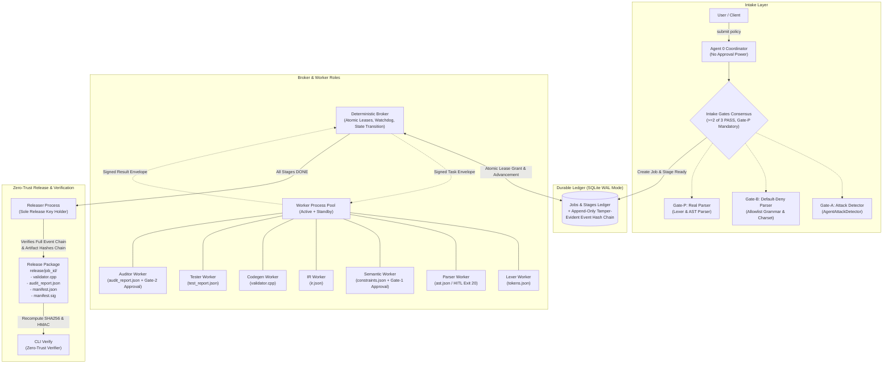

# Resilient Zero-Trust Compiler Pipeline

A resilient, zero-trust job orchestration pipeline built around the deterministic C++ password-policy compiler (`policy_compiler`).

The pipeline decomposes monolithic compilation into isolated worker processes coordinated through a durable SQLite Write-Ahead Logging (WAL) ledger with a tamper-evident cryptographic event hash chain and HMAC-SHA256 signed task and result envelopes. A crashed or compromised worker/coordinator cannot cause an unsafe release, and in-flight jobs automatically recover and resume upon broker restart.

---

## 1. System Architecture



---

## 2. Key Security Properties

1. **Zero-Trust Role Permissions**:
   - Each worker role holds only its own private role key (`keys/<role>.key`).
   - Workers strictly produce only their assigned single artifact:
     - `lexer` -> `tokens.json`
     - `parser` -> `ast.json` (or exit code 20 on ambiguous syntax requiring human authorization)
     - `semantic` -> `constraints.json` + signed Gate-1 approval
     - `ir` -> `ir.json`
     - `codegen` -> `validator.cpp`
     - `tester` -> `test_report.json`
     - `auditor` -> `audit_report.json` + signed Gate-2 approval
   - The coordinator (Agent 0) has **zero approval power**.

2. **Tamper-Evident Append-Only Event Chain**:
   - Every state transition, lease event, and gate vote is logged to SQLite in WAL mode.
   - Each event record stores `prev_hash` + its own `event_hash = SHA256(job_id | stage | event_type | payload | prev_hash | timestamp)`.
   - Modifying or deleting any historical ledger row breaks the cryptographic chain.

3. **Multi-Gate Intake Defense-in-Depth**:
   - **Gate-A**: C++ AST & prompt injection attack detector (`--stage guard`).
   - **Gate-B**: Independent Python default-deny parser enforcing strict allowlist line grammar, 64 KB limit, and rejection of control/bidi/zero-width Unicode tricks.
   - **Gate-P**: Deterministic grammar acceptance by the real compiler lexer/parser.
   - Consensus requires $\ge 2$ of 3 PASS votes with Gate-P mandatory.
   - **Degraded Mode**: An operator can isolate a suspected/compromised gate (`cli isolate <gate>`), requiring unanimous agreement from remaining gates and tagging the release as `DEGRADED`.

4. **Cryptographic Release Provenance**:
   - Releaser signs `manifest.sig` using `releaser.key` **only if**:
     1. Event hash chain verifies from genesis to head.
     2. Artifact hashes chain continuously: `policy -> tokens -> ast -> constraints -> ir -> validator -> test -> audit`.
     3. Semantic Gate-1 approval and Auditor Gate-2 approval (signed by distinct keys) both reference the exact same `validator.cpp` hash.
     4. Conformance tests all passed ($100\%$).

---

## 3. How to Run the Fault-Injection Demo

Execute the end-to-end automated fault injection benchmark:

```bash
python demo_faults.py
```

### Fault Scenarios Demonstrated:

| # | Scenario | Mechanism | Result |
|---|---|---|---|
| **1** | **Kill Active Coordinator** | Active Agent 0 killed mid-job via `Popen.kill()`; remaining stages execute to completion from durable SQLite ledger state. | **PASS** |
| **2** | **Forged Approvals & Compromised Gate-A** | Replayed nonces, fake HMAC keys, and illegal stage jumps are rejected and logged as `ALERT`. Forced PASS on Gate-A for an adversarial prompt-injection policy is blocked by Gate-B and Gate-P. | **PASS** |
| **3** | **Kill Codegen Worker Mid-Task** | Active codegen worker killed during code synthesis; broker detects expired lease (2.0s), resets stage to `READY`; standby worker leases and finishes; `validator.cpp` SHA256 matches clean reference compile. | **PASS** |
| **4** | **Artifact Tampering Between Stages** | An artifact (`ir.json`) is tampered on disk between stages; next worker verifies `input_hash` against task envelope, detects mismatch, rejects task, and aborts job with zero release. | **PASS** |
| **5** | **Broker Process Killed & Restarted** | Broker process killed mid-job; second broker process restarts, recovers in-flight state from SQLite WAL, and resumes execution to release. | **PASS** |

---

## 4. CLI Reference

Initialize keys and SQLite ledger:
```bash
python cli.py init
```

Submit a policy file into the pipeline:
```bash
python cli.py submit tests/policy_dsl2.txt
```

Check job and stage progress:
```bash
python cli.py status <job_id>
```

Authorize ambiguous syntax repair candidate:
```bash
python cli.py approve <job_id> A
```

Isolate a compromised gate into safe degraded mode:
```bash
python cli.py isolate Gate-A
```

Verify release package provenance and integrity:
```bash
python cli.py verify release/<job_id>
```

Testing zero-trust tamper detection:
```bash
# Modify 1 byte of the released validator
echo // tampered >> release/<job_id>/validator.cpp
python cli.py verify release/<job_id>
# Exit code 1: validator.cpp integrity verification FAILED. Hash mismatch
```

---

## 5. Honest Limits & Assumptions

1. **Local HMAC Keys vs. Hardware Isolation**:
   - In this implementation, role keys are stored in `keys/` on the local filesystem. This demonstrates the cryptographic envelope and protocol logic, but does **not** provide physical hardware isolation. In production, keys should be protected by Hardware Security Modules (HSM), Cloud KMS, or Trusted Execution Environments (TEE / Nitro Enclaves).
2. **Trusted Computing Base (TCB)**:
   - The broker process, the releaser process, the SQLite WAL ledger file, and the filesystem holding the keys constitute the trusted base of the machine. A root/kernel-level compromise on the host could manipulate the database engine or read keys from memory.
3. **Byzantine Gate Collusion**:
   - The multi-gate intake system ($2$-of-$3$ threshold) protects against a single compromised gate. By fundamental Byzantine fault tolerance principles, if a majority of gates (e.g. 2 out of 3) are compromised and collude, pure software consensus without external ground truth cannot prevent a malicious policy from passing intake.
